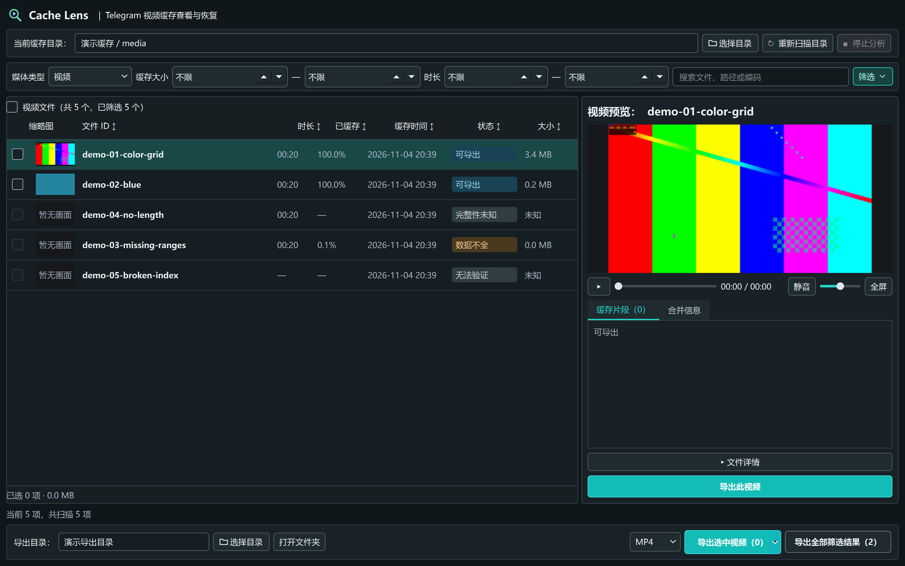

<p align="center"></p>
<h1 align="center">TG Cache Lens</h1>
<p align="center">在电脑上查看 Telegram 的视频缓存，预览可用内容并导出视频或片段。</p>



Cache Lens 是一个开源桌面工具，支持 Windows 上的官方 Telegram Desktop 缓存，以及 macOS 原生 Telegram 的 MediaBox 缓存。无需登录 Telegram，处理过程在本机完成；程序读取缓存并将结果写入另一个目录。

截图使用 FFmpeg 生成的演示视频，未使用私人聊天或缓存画面。项目与 Telegram 官方无关联。

## 能做什么

- 浏览、搜索视频缓存，按时长、缓存大小、覆盖率、缓存时间和状态排序或筛选。Desktop 扫描过程中会逐步显示已识别的视频。
- 在窗口中预览，单个或批量导出 MP4、MKV 或原格式；当前导出目录中已有的结果会在列表中标记。
- 对可分析的缺片视频逐步显示可播放片段；较长的缓存区间会按关键帧拆分，支持在右侧预览并合并导出所选片段。
- 同一次运行中，重新扫描会复用未变化的 Desktop 缓存结果；切换视频后可复用最近完成的片段分析。程序关闭时会清理这些临时文件。
- 较大的 Desktop 视频优先读取缓存头尾，点开或导出时再加载完整缓存；列表中的“待加载”项目会在加载后补全可用状态和缓存大小。
- 记住上次选择的缓存目录与导出目录；支持重新扫描、停止分析、跳过已导出视频以及重试失败项。

缓存中不存在的数据无法恢复。并非所有缓存格式或损坏视频都能解析；Desktop 连续缓存可导出，但它的已知范围不一定能证明原视频的完整长度。

## Windows 快速开始

1. 从 [Releases](https://github.com/gongfpp/tg-cache-lens/releases) 下载 `tg-cache-lens-0.5.4-windows-x64.zip`，解压整个文件夹，双击 `Cache Lens.exe`。
2. 安装 [FFmpeg](https://ffmpeg.org/download.html)，确保 `ffmpeg` 和 `ffprobe` 可以从 PATH 运行；程序也会查找当前用户的 WinGet Links 目录。
3. 点击“选择目录”，选择 Telegram Desktop portable 程序目录或 `tdata`，选择后开始扫描。“筛选”菜单中也可使用自动扫描；多个候选目录时请手动选择。
4. 选择导出目录，点击视频预览或勾选后导出。缺片视频可分析片段，再选择片段合并导出。

Windows ZIP 包含应用运行时，不包含 FFmpeg 命令行工具。若 Telegram 设置了本地密码，需要在程序中输入该本地密码。Windows 支持经过合成数据与实际 Desktop portable 缓存验证；不同客户端版本和缓存状态可能影响结果。

## macOS 和源码运行

当前新版本可从源码运行；[v0.4.0 Release](https://github.com/gongfpp/tg-cache-lens/releases/tag/v0.4.0) 另有旧版 Apple Silicon 应用包，不包含此版本的新功能。macOS 需要安装 `ffmpeg` 和 `ffprobe`，例如 `brew install ffmpeg`。

安装 Git、Python 3.10+、[uv](https://docs.astral.sh/uv/getting-started/installation/) 和 FFmpeg 后：

```sh
git clone https://github.com/gongfpp/tg-cache-lens.git
cd tg-cache-lens
uv sync --frozen --extra gui
uv run --extra gui tg-cache-lens gui
```

也可以指定目录：

```sh
uv run --extra gui tg-cache-lens gui --cache /path/to/cache --output /path/to/exports
```

macOS 首次读取 Telegram 目录时，系统可能要求允许访问其他应用数据。Windows 源码用户可运行 `Start-Windows.bat`；构建 Windows 程序使用 `.\scripts\build_windows.ps1`，输出位于 `build/windows/Cache Lens`。

## 使用说明

缓存目录和导出目录应分开。程序不会覆盖已有输出，同名文件会自动增加编号。导出前会重新检查缓存，导出结果会进行解码检查；读取失败或缓存发生变化时，界面会列出错误。

列表中的“已导出”和“已导出片段”根据**当前导出目录**的文件名识别；文件改名或移走后标记会随之变化。导出按钮的菜单可以选择“跳过已导出视频”，片段导出记录不会被当作完整视频跳过。搜索和筛选不会清除已勾选项，导出选中视频时也包含被筛选隐藏的勾选项。

Desktop 的缓存时间来自可用的缓存索引时间；没有对应记录时显示未知。视频时长、缓存大小和可恢复片段取决于本地实际保存的数据。

## 命令行

运行 `tg-cache-lens` 打开交互式命令行；也可以运行：

```sh
tg-cache-lens --scan --deep
tg-cache-lens export --all-complete --output ./exports
tg-cache-lens export --file /path/to/cache-file --format mp4 --output ./exports
```

`--scan` 输出的 JSON 可能包含本机路径。可用 `--timeout 1800` 增加单次媒体处理超时秒数。Desktop 本地密码可通过 `TG_CACHE_LENS_PASSCODE` 环境变量提供给命令行扫描。

## 开发和验证

```sh
uv sync --frozen --extra gui
uv run --extra gui pytest -q
uv run python scripts/capture_demo.py
uv run --extra gui tg-cache-lens gui --cache .local/demo/media --output .local/demo-export
```

演示素材由 FFmpeg 测试信号生成。项目验证记录见 [docs/verification.md](docs/verification.md)。发布前请勿提交真实缓存、导出视频、扫描报告或包含私人画面的截图。

## 许可

项目代码与自制图标使用 [MIT License](LICENSE)。MediaBox 和 Desktop 缓存读取依据 Telegram 公开源码独立实现。GUI 使用 Qt / PySide6；应用包附带依赖许可与上游源码位置。外部 FFmpeg 命令行工具需单独安装。
