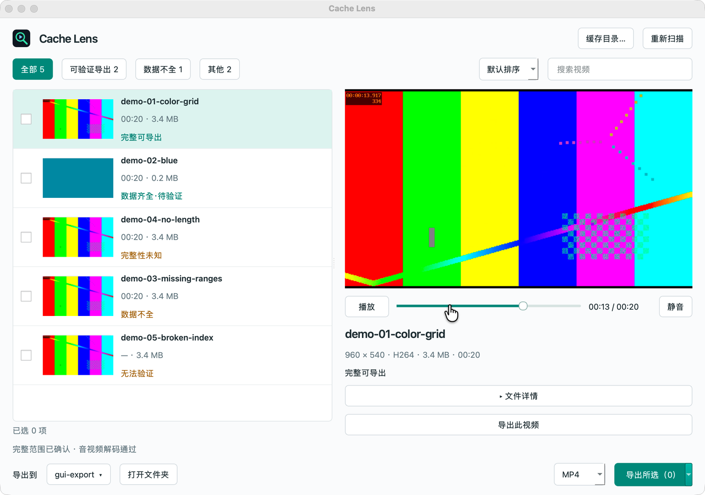
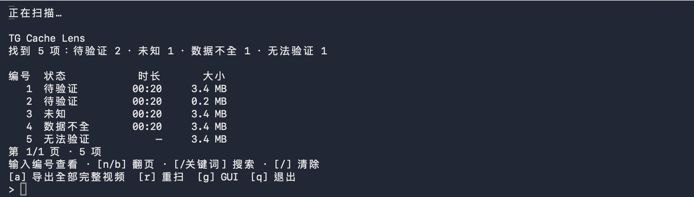

<p align="center"></p>
<h1 align="center">TG Cache Lens</h1>
<p align="center">检查 Telegram 本地视频缓存，用简洁命令行或独立 Mac 窗口预览、导出完整视频。</p>



支持 **macOS 原生 Telegram 的 MediaBox 缓存**。读取 `.meta` 的字节范围，结合 FFmpeg 全程解码，区分完整视频与缺片文件。全程本地处理，无须登录，不连接 Telegram 服务，不修改缓存。不能补回本地不存在的数据；Qt 版 Telegram Desktop 的 `tdata` 不在支持范围内。

截图来自真实运行的应用，使用 FFmpeg 生成的测试画面，不含私人聊天或缓存内容。

## 开始使用

先安装媒体工具：

```sh
brew install ffmpeg
```

**Apple Silicon Mac：** 从 [Releases](https://github.com/gongfpp/tg-cache-lens/releases/latest) 下载 `tg-cache-lens-0.2.0-macos-arm64.zip` 并解压：

- 双击 **Cache Lens.app** 打开独立窗口，可将它拖入“应用程序”。
- 双击 **tg-cache-lens/Launch.command** 打开简洁命令行。

安装包包含 Python 与 GUI 运行时，外部 `ffmpeg`、`ffprobe` 仍需上面的一步安装。应用未做 Apple 开发者签名或公证；首次打开可能需要在 macOS“隐私与安全性”中允许打开。

**从源码运行（Python 3.10+）：**

```sh
git clone https://github.com/gongfpp/tg-cache-lens.git
cd tg-cache-lens
uv sync --frozen --extra gui
uv run --extra gui tg-cache-lens gui
```

只用命令行可省略 `--extra gui`。也可从 Release 安装 wheel：`pip install './tg_cache_lens-0.2.0-py3-none-any.whl[gui]'`；省略 `[gui]` 则不安装窗口依赖。

默认自动查找当前用户的 Telegram Group Container，导出到 `~/Downloads/Telegram Exports`。可在 GUI 选择目录，或用参数指定：

```sh
tg-cache-lens --cache '/path/to/postbox/media' --output './exports'
```

## Mac 窗口

以下为当前源码的按需浏览体验，已发布的 v0.2.0 安装包仍使用自动扫描界面。

1. 启动后不扫描。点击“自动扫描缓存”定位原生 Telegram 目录，或点击“手动选择…”选择兼容的 MediaBox 目录并扫描。macOS 首次读取目录时可能询问是否允许“访问其他应用的数据”。
2. 列表默认只显示文字，支持名称搜索、完整性筛选、大小／时长排序，以及已缓存大小范围筛选。默认排除疑似动图／贴纸；可以切换到“疑似动图 / 贴纸”或“全部类型”。
3. 点击“缩略图”才生成列表画面；选中视频并点击“预览”才验证完整性并播放。预览支持暂停、拖动进度和静音；切换条目、重新扫描或关闭预览时停止播放。技术信息收在“文件详情”。
4. 点击预览区的“导出此视频”，或直接勾选多行后点击“导出所选”。旁边的箭头菜单可以“导出全部完整视频”、选择当前列表的可导出项、取消勾选。
5. 底部选择导出目录和 MP4、MKV 或原格式。完成后显示成功／失败数量，“打开文件夹”查看结果，有失败时点击“查看失败原因”，无需开启预览。

疑似动图／贴纸按“无音轨、时长不超过 30 秒、宽高不超过 512”判断，可能包含普通短视频；切换“全部类型”可找回。静态图片和仅含封面图的音频不列为视频。已缓存大小来自有效索引，缺少索引时显示未知；设置大小上下限后不包含未知项，清除范围可恢复。扫描仍会读取文件头、索引和媒体信息；缩略图与预览开关控制画面生成和播放。

“可验证导出”包含索引覆盖完整长度的候选文件，**实际导出前仍需全程解码通过**。数据不全、未知长度和无法验证的文件不能勾选或导出。缩略图只表示读到了某一帧，不证明完整性。

搜索和筛选不会清除勾选；“导出所选”包含隐藏的已选项，“导出全部完整视频”处理整个扫描结果。扫描、预览准备和导出在后台进行；任务未结束时关闭窗口，会等待当前处理完成再清理临时文件。

## 简洁命令行

直接运行 `tg-cache-lens`，自动扫描后显示摘要和每页 10 项的简表。输入编号，再选择预览或导出；不使用全屏界面，也无需调整终端尺寸。



| 输入 | 操作 |
|---|---|
| 数字 | 查看该项，然后 `p` 预览、`e` 导出、回车返回 |
| `n` / `b` | 下一页 / 上一页 |
| `/关键词` / `/` | 搜索文件名 / 清除搜索 |
| `a` | 验证并导出全部完整视频 |
| `r` / `g` / `q` | 重新扫描 / 打开 GUI / 退出 |

命令行预览使用系统默认播放器，临时预览文件在退出时清理；GUI 使用内嵌播放器。默认导出 MP4，可用 `--format mkv` 或 `--format original` 更改。

**无需交互的命令**：

```sh
# 与 v0.1 的 JSON 扫描接口兼容
tg-cache-lens --scan --deep > report.json
# 批量验证并导出
tg-cache-lens export --all-complete
# 单个缓存；完整性不通过时返回非零退出码
tg-cache-lens export --file '/path/to/cache-file' --format mp4 --output './exports'
# 打开图形界面
tg-cache-lens gui
# 较长视频增加每次解码和导出的超时，单位为秒
tg-cache-lens --timeout 1800
```

JSON 包含本机路径。批量导出向终端列出失败原因，有失败时返回非零退出码。

## 检测与导出规则

| 状态 | 依据 | 允许导出 |
|---|---|---|
| 完整可导出 | 索引确认完整长度，全部音视频流解码通过 | 是，导出前再次验证 |
| 数据齐全·待验证 | 索引覆盖完整长度，尚未全程解码 | 点击导出时先验证 |
| 数据不全 | 索引有缺口，或文件短于索引记录 | 否 |
| 完整性未知 | 缺少完整长度依据；即使可解码，也不能排除截断 | 否 |
| 无法验证 | 索引损坏、解码失败、超时或扫描期间文件变化 | 否 |

同一资源的多份缓存会合并显示。文件大小可能包含空洞或预分配区域，**不等于实际下载量**。无可识别文件头的缓存不在列表中；视频贴纸可能被纳入。时长和解码通过不能单独证明完整性。

MP4 优先无损重新封装；编码不适合 MP4 时转为 H.264/AAC。MKV 无损封装，原格式保留字节。输出会再次解码检查；缓存发生变化则中止；已有文件不会覆盖，同名自动增加编号。

## 开发与验证

```sh
uv sync --frozen --extra gui
uv run --extra gui pytest -q
# 生成公开测试视频，用真实应用打开后截图
uv run python scripts/capture_demo.py
uv run --extra gui tg-cache-lens gui --cache .local/demo/media --output .local/demo-export
# 构建 Apple Silicon 安装包内容
./scripts/build_macos.sh
```

测试覆盖完整性判断、损坏索引、重复缓存合并、导出前复验、防覆盖、MP4/MKV/原格式、WebM 转 MP4、命令行菜单与非交互导出，以及 GUI 的筛选、多选、播放帧、进度与失败提示。真实 Mac 窗口和私有缓存的实测边界记录在 [验证记录](docs/verification.md)。

## 许可

项目代码与自制图标使用 [MIT License](LICENSE)。索引解析依据 Telegram 公开的 [MediaBoxFileMap.swift 格式](https://github.com/TelegramMessenger/Telegram-iOS/blob/master/submodules/Postbox/Sources/MediaBoxFileMap.swift) 独立实现。测试画面由 FFmpeg 的测试信号生成。

GUI 使用动态链接的 Qt / PySide6，按 LGPLv3 分发，安装包附带依赖声明、许可证及上游源码位置。Qt 播放后端包含其 LGPL FFmpeg 库；扫描和导出调用的 `ffmpeg` / `ffprobe` 命令行工具不随包分发。构建脚本会收集 [Qt 官方许可说明](https://doc.qt.io/qtforpython-6/licenses.html) 和第三方声明；可替换／重编译依赖后重新签名运行。
