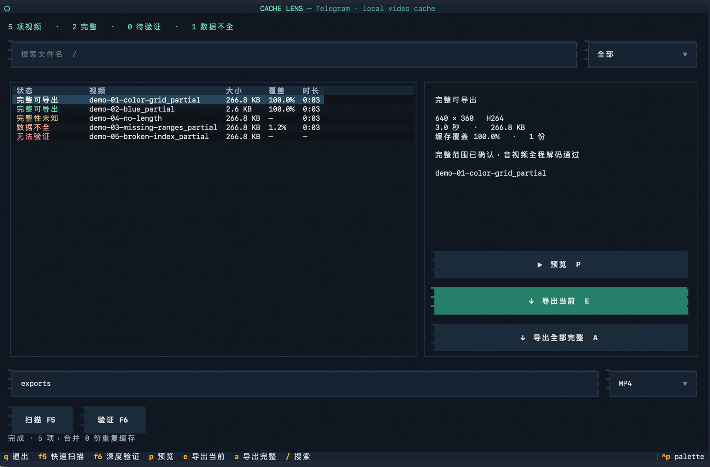
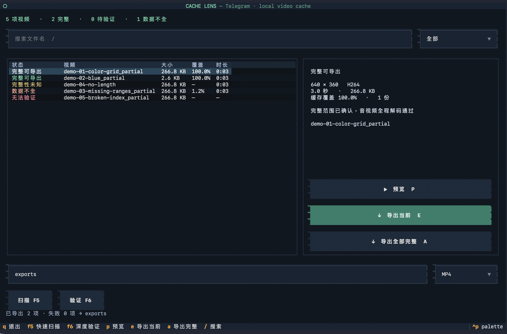

<p align="center"></p>
<h1 align="center">TG Cache Lens</h1>
<p align="center">在终端里检查 Telegram 视频缓存，预览并导出完整视频。</p>



支持 **macOS 原生 Telegram 的 MediaBox 缓存**。读取 `.meta` 中的字节范围，结合 FFmpeg 全程解码，区分完整视频与缺片文件。全程本地处理，无须登录、不连接 Telegram 服务、不修改缓存。不是下载器，不能补回本地不存在的数据。Qt 版 Telegram Desktop 的 `tdata` 缓存不在当前支持范围内。

截图来自 macOS 终端内实际运行的 TUI，仅裁去含用户名的系统标题栏；使用 FFmpeg 生成的测试素材，不含私人聊天或缓存内容。

## 开始使用

需要 **FFmpeg**；源码安装另需 Python 3.10+。

```sh
brew install ffmpeg
```

**Apple Silicon Mac：** 从 [Releases](https://github.com/gongfpp/tg-cache-lens/releases/latest) 下载 `tg-cache-lens-*-macos-arm64.zip`，解压后双击 `Launch.command`，或在终端运行其中的 `tg-cache-lens`。此包包含 Python 运行时，不包含 FFmpeg，也未做 Apple 签名或公证。

**从源码安装：**

```sh
git clone https://github.com/gongfpp/tg-cache-lens.git
cd tg-cache-lens
uv sync --frozen --no-dev
uv run tg-cache-lens
```

也可以从 Release 下载 wheel 后运行 `pip install ./tg_cache_lens-*.whl`。

默认自动查找当前用户的 Telegram Group Container，并将导出文件写入 `~/Downloads/Telegram Exports`。其他目录可以指定：

```sh
tg-cache-lens --cache '/path/to/postbox/media' --output './exports'
```

## 使用

- **F5 / 扫描**：快速读取索引和媒体信息。右上角筛选状态，`/` 搜索文件名。
- **F6 / 验证**：对没有已知缺口的候选文件进行全程解码。扫描期间显示当前进度，界面仍可响应。
- **点击列表或方向键选择**：右侧显示编码、尺寸、时长、覆盖率与验证依据。
- **P / 预览**：验证完整性，生成临时 MP4，用系统默认播放器打开。预览文件在退出 TUI 时清理。
- **E / 导出当前**：选择 MP4、MKV 或原格式，再导出当前视频。
- **A / 导出全部完整**：处理所有完整或待验证项，逐个复验，通过后才写入输出目录。此操作不受列表筛选影响。
- **Q**：退出。窄终端自动切换为上下布局，建议至少 85 列 × 36 行。

MP4 优先无损重新封装；不适合 MP4 的编码会转为 H.264/AAC。MKV 无损封装，原格式保留源文件字节。已有输出不会覆盖，同名文件自动增加编号。批量失败会显示数量，并写入输出目录的 `export-errors.txt`。



## 如何理解检测结果

| 状态 | 依据 | 允许导出 |
|---|---|---|
| 完整可导出 | 索引确认完整长度，全部音视频流解码通过 | 是，导出前再次验证 |
| 数据齐全·待验证 | 索引覆盖完整长度，尚未全程解码 | 点击导出时先验证 |
| 数据不全 | 索引有缺口，或文件短于索引记录 | 否 |
| 完整性未知 | 缺少完整长度依据；即使可解码，也不能排除截断 | 否 |
| 无法验证 | 索引损坏、解码失败、超时或扫描期间文件变化 | 否 |

同一资源的多份缓存会合并显示。文件大小可能包含空洞或预分配区域，**不等于实际下载量**。无可识别文件头的缓存不在视频列表中；WebM 视频贴纸可能被纳入。视频时长也不能单独证明完整性。

非交互扫描仍然可用；JSON 中会包含本机文件路径，请自行决定分享范围：

```sh
tg-cache-lens --scan --deep > report.json
# 较长视频可以增加单次解码/导出的超时，单位为秒
tg-cache-lens --timeout 1800
```

## 开发与验证

```sh
uv sync --frozen
uv run pytest -q
# 生成测试素材，运行真实界面并捕获截图（不读取私人缓存）
env -u NO_COLOR TERM=xterm-256color uv run python scripts/capture_demo.py
# 本机打包
./scripts/build_macos.sh
```

测试覆盖：完整/缺片/未知长度、损坏索引与视频、重复缓存合并、导出前复验、防覆盖、MP4/MKV/原格式、WebM→MP4，以及 TUI 点击、筛选、单项和批量导出。自动测试中的系统播放器启动被替换；播放器打开流程另在 macOS 上手动实测。

## 参考与许可

交互参考 [Lazygit](https://github.com/jesseduffield/lazygit) 的列表、详情和快捷键组织方式，基于 [Textual](https://github.com/Textualize/textual) 实现，未复制参考项目界面资源。索引解析依据 Telegram 的公开 [MediaBoxFileMap.swift 格式](https://github.com/TelegramMessenger/Telegram-iOS/blob/master/submodules/Postbox/Sources/MediaBoxFileMap.swift) 独立实现。

项目代码与自制图标使用 [MIT License](LICENSE)。截图素材通过 FFmpeg 的测试信号生成。FFmpeg 作为外部依赖安装，其许可证取决于用户安装的构建；Release 不捆绑 FFmpeg。二进制分发附带所含 Python 依赖的许可证。
