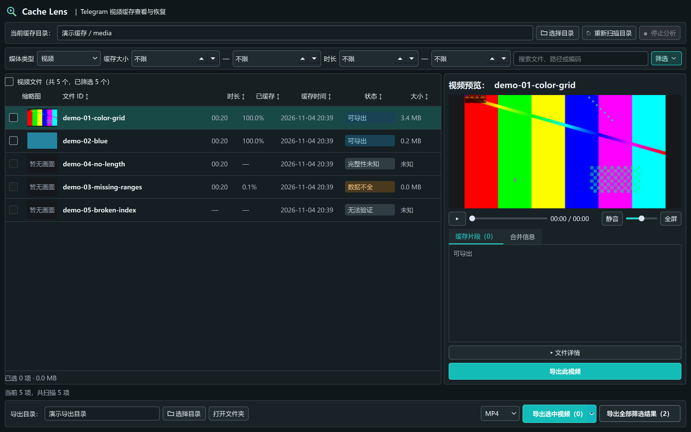

# 给 Telegram 缓存的视频一个可看的列表：我做了 Cache Lens

你可能遇到过这样的情况：在 Telegram 里看过一段视频，后来想把它整理出来，却发现电脑上找不到一个容易辨认的视频文件。Telegram 为了播放和节省空间，会把部分内容放在自己的缓存中；缓存文件的名称和结构，也不适合直接浏览。

因此我做了一个开源小工具：**TG Cache Lens**。它把支持识别的视频缓存整理成列表，让你按时长、大小和缓存时间查找，在窗口里预览，再把需要的内容导出到自己选定的目录。

目前支持 Windows 官方 Telegram Desktop 的缓存，包括 portable 目录；macOS 原生 Telegram 的 MediaBox 缓存也可以从源码使用。程序在本机处理，不需要 Telegram 登录。上图使用的是 FFmpeg 生成的演示画面。

对于缓存不完整的视频，Cache Lens 会尝试分析本地现有的数据。能解码的片段会陆续出现在右侧，你可以逐个预览，选择需要的片段合并为一个文件。已经导出到当前目录的视频也会在列表中标记，方便整理。

开始使用很简单：

1. Windows 用户从 [GitHub Releases](https://github.com/gongfpp/tg-cache-lens/releases) 下载并解压程序，另行安装 FFmpeg。
2. 在程序里选择 Telegram Desktop 程序目录或 `tdata`，扫描后浏览列表。
3. 选一个独立的导出目录，预览并导出视频，或者分析和合并可用片段。

它能处理的是**仍然保存在本机、且能够识别和解码的数据**：已经清理掉的缓存不会凭空找回；不同格式的缺片也不一定能恢复出可播放片段。如果使用中遇到某种缓存无法识别，欢迎带上客户端版本、操作系统和错误描述到 GitHub 提交 issue；请不要上传私人缓存或聊天内容。

项目地址：[github.com/gongfpp/tg-cache-lens](https://github.com/gongfpp/tg-cache-lens)

如果你也有整理本地视频缓存的需求，欢迎试用并告诉我：你最希望它先改善扫描速度、筛选方式，还是片段恢复体验？
